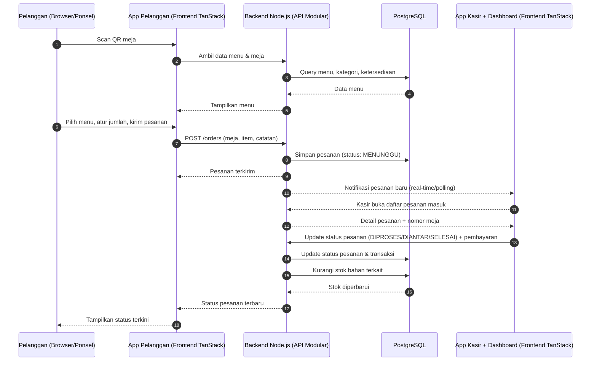
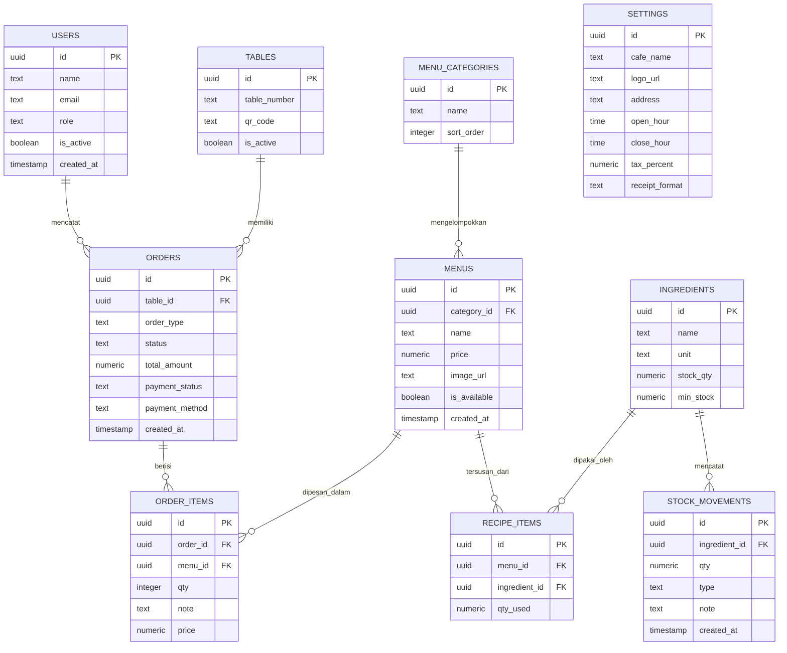

# PRD — Project Requirements Document

## 1. Overview

**IUL FnB** adalah sistem pemesanan digital untuk kafe dan restoran yang menyatukan pengalaman pelanggan dan operasional kasir dalam satu platform. Saat ini, pesanan sering dicatat secara manual sehingga mudah hilang, tidak tercatat, atau salah catat — akibatnya pelanggan menunggu lama dan pemilik tidak memiliki gambaran penjualan maupun stok yang akurat.

IUL FnB menyelesaikan masalah tersebut dengan **dua aplikasi frontend yang terpisah** (build & deploy sendiri-sendiri), keduanya terhubung ke satu backend:

- **App QR Menu (Pelanggan)** — pelanggan memindai QR di meja, melihat menu, memesan, dan memantau status pesanannya sendiri **tanpa perlu menunggu pelayan dan tanpa memasang aplikasi apa pun**. Hanya berisi alur pelanggan (menu, keranjang, kirim pesanan, lacak status).
- **App Kasir + Dashboard (Internal)** — satu aplikasi internal untuk kasir **dan** pemilik: kasir menerima semua pesanan di satu layar, memprosesnya, mencatat pembayaran, sedangkan pemilik mengelola menu, meja/QR, stok bahan, akun staf, pengaturan kafe, serta memantau dashboard penjualan. Semua tampilan internal (POS + admin/owner) berada di aplikasi ini, diakses sesuai peran.

**Tujuan Utama:**

1. Pelanggan bisa memesan sendiri dalam hitungan detik lewat QR di meja.
2. Setiap pesanan tercatat rapi sehingga **tidak ada lagi pesanan yang salah atau terlewat**.
3. Kasir bekerja dari satu layar utama yang ringkas dan jelas.
4. Pemilik bisa melihat penjualan harian dan sisa stok bahan tanpa menghitung manual.

Kemenangan pertama yang ingin dicapai: **pelanggan berhasil memesan satu makanan lewat QR, dan pesanan itu langsung muncul di layar kasir.**

## 2. Requirements

**Fungsional**

- Pelanggan dapat membuka menu hanya dengan memindai QR di meja (tanpa unduh aplikasi).
- Pelanggan dapat memilih menu, mengatur jumlah, menambahkan catatan, dan mengirim pesanan.
- Pesanan dari pelanggan langsung masuk ke layar kasir secara real-time.
- Kasir dapat mencatat pesanan manual (pelanggan walk-in tanpa QR).
- Kasir dapat memperbarui status pesanan (diproses → siap → diantar/selesai) dan menandai pembayaran.
- Pemilik dapat mengelola menu, meja, QR, stok bahan, akun staf, dan melihat dashboard penjualan.
- Sistem dapat menandai menu habis dan memberi peringatan saat stok bahan menipis.

**Non-Fungsional**

- **Satu backend, arsitektur modular** dalam satu monorepo — pelanggan dan kasir berbagi data yang sama.
- **Dua frontend terpisah**: App QR Menu (khusus pelanggan) dan App Kasir + Dashboard (khusus internal/kasir & pemilik), masing-masing punya build & bundle sendiri agar halaman pelanggan tetap ringan dan area internal bisa lebih berat.
- **Cepat & ringan**: halaman menu QR harus terbuka mulus di ponsel biasa.
- **Akurat**: setiap perubahan status pesanan dan stok tercatat konsisten.
- **Aman**: akses dibagi berdasarkan peran (pemilik vs kasir).
- **Sederhana dipakai**: kasir dan pemilik non-teknis dapat mengoperasikannya tanpa pelatihan panjang.

## 3. Core Features

### Fase 1 — Fondasi Pemesanan
**Pesan via QR** *(high)*
- **Buka Menu dari QR** — pelanggan memindai QR di meja dan langsung melihat daftar menu.
- **Pilih & Atur Pesanan** — memilih menu, mengatur jumlah, menambah catatan khusus.
- **Keranjang & Kirim** — memeriksa ulang pesanan lalu mengirim ke kasir dalam satu langkah.
- **Lacak Status Pesanan** — pelanggan melihat pesanannya sedang diproses, siap, atau sudah diantar.

**Layar Kasir** *(high)*
- **Daftar Pesanan Masuk** — pesanan baru dari QR muncul lengkap dengan detail dan nomor meja.
- **Input Pesanan Manual** — kasir mencatat pesanan pelanggan yang datang langsung.
- **Tandai Pesanan Selesai** — kasir menandai pesanan yang sedang dibuat dan yang sudah diantar.
- **Pembayaran & Struk** — kasir mencatat pembayaran tunai/non-tunai dan mencetak struk.

### Fase 2 — Pengelolaan Menu, Meja & Stok
**Kelola Menu & Meja** *(medium)*
- **Tambah & Ubah Menu** — pemilik menambah menu baru atau mengubah nama, harga, dan foto.
- **Kelompokkan Menu** — makanan, minuman, dan lainnya agar mudah dipilih pelanggan.
- **Tandai Menu Habis** — menu kosong ditandai agar tidak bisa dipesan.
- **Atur Meja & QR Code** — membuat daftar meja dan mencetak QR unik tiap meja.

**Stok Bahan** *(high)*
- **Lihat Sisa Bahan** — pemilik dan kasir melihat sisa bahan penting dalam satu layar.
- **Catat Bahan Masuk** — penambahan bahan saat restock dicatat agar jumlah akurat.
- **Stok Berkurang Otomatis** — stok berkurang setiap menu yang memakainya terjual.
- **Peringatan Stok Menipis** — pemberitahuan muncul saat bahan hampir habis.

### Fase 3 — Insight & Akun
**Dashboard Penjualan** *(high)*
- **Ringkasan Hari Ini** — total penjualan, jumlah pesanan, dan menu terlaris.
- **Grafik Penjualan** — tren harian dan mingguan dalam grafik yang mudah dibaca.
- **Riwayat Transaksi** — semua transaksi dapat ditelusuri kembali kapan saja.
- **Unduh Laporan** — laporan penjualan bisa diunduh untuk pembukuan atau pajak.

**Akun & Hak Akses** *(medium)*
- **Masuk & Keluar Akun** — kasir dan pemilik masuk dengan akun masing-masing.
- **Atur Peran Pengguna** — pemilik menentukan siapa boleh membuka kasir, mengubah menu, atau melihat laporan.
- **Kelola Akun Staf** — menambah atau menonaktifkan akun staf yang bergabung/berhenti.

### Fase 4 — Penyesuaian Kafe
**Pengaturan Kafe** *(low)*
- **Profil Kafe** — nama, logo, dan alamat muncul di semua tampilan pelanggan.
- **Jam Operasional** — jam buka dan tutup tampil di halaman menu.
- **Pajak & Biaya Layanan** — persentase pajak/biaya layanan otomatis masuk ke tagihan.
- **Format Struk** — informasi struk pelanggan dapat disesuaikan pemilik.

## 4. User Flow

**A. Pelanggan Memesan via QR (Fase 1)**
1. Pelanggan duduk di meja, memindai QR dengan kamera ponsel.
2. Halaman menu kafe terbuka di browser (tanpa install aplikasi).
3. Pelanggan memilih menu, mengatur jumlah, dan menambah catatan (mis. "tanpa gula").
4. Pelanggan membuka keranjang, memeriksa ulang pesanan, lalu menekan **Kirim Pesanan**.
5. Pesanan langsung muncul di layar kasir beserta nomor meja.
6. Pelanggan memantau status: **Diproses → Siap → Diantar**.

**B. Kasir Memproses Pesanan**
1. Kasir melihat pesanan baru masuk di daftar pesanan.
2. Kasir memproses dan menandai pesanan sebagai **Diproses**, lalu **Diantar/Selesai**.
3. Kasir mencatat pembayaran (tunai/non-tunai) dan menyerahkan struk.
4. Untuk pelanggan tanpa QR, kasir mencatat pesanan secara manual dari layar yang sama.

**C. Pemilik Mengelola Operasional (Fase 2–4)**
1. Pemilik masuk ke akunnya dengan peran "Pemilik".
2. Mengelola menu, kategori, harga, dan menandai menu habis.
3. Mengatur daftar meja dan mencetak QR tiap meja.
4. Mencatat bahan masuk; sistem otomatis mengurangi stok saat penjualan terjadi.
5. Membuka dashboard penjualan untuk melihat ringkasan, grafik, dan mengunduh laporan.
6. Menambah/menonaktifkan akun staf dan mengatur hak akses.
7. Menyesuaikan profil kafe, jam operasional, pajak, dan format struk.

## 5. Architecture

Sistem ini menggunakan **satu backend modular** yang melayani **dua aplikasi frontend terpisah** dalam satu monorepo: **App QR Menu** untuk pelanggan dan **App Kasir + Dashboard** untuk internal (kasir & pemilik). Keduanya punya entry point, build, dan deploy sendiri, tetapi berkomunikasi dengan API backend yang sama sehingga data pesanan dan stok selalu sinkron. Modul backend dipisah per domain (Pesanan, Menu, Stok, Penjualan, Akun) agar mudah dikembangkan per fase.

**Layer utama:**
- **App QR Menu (Web Pelanggan)** — halaman menu, keranjang, checkout, pelacakan status. Hanya alur pelanggan.
- **App Kasir + Dashboard (Web Internal)** — layar kasir (daftar pesanan, input manual, pembayaran, struk) **dan** area pemilik (menu, meja & QR, stok, akun & peran, dashboard penjualan, pengaturan kafe), dipisah berdasarkan peran.
- **Backend Modular (Node.js)** — modul Pesanan, Menu & Meja, Stok, Penjualan, Akun & Peran, Pengaturan Kafe.
- **PostgreSQL** — sumber data tunggal untuk semua aplikasi.
- **Docker** — menjalankan dua frontend (QR Menu & Kasir+Dashboard), backend, dan database dalam satu ekosistem.

## 6. Database Schema

Berikut tabel-tabel utama yang dibutuhkan (nama tabel disederhanakan).

**users** — akun staf & pemilik
- `id` (UUID) — kunci utama
- `name` (text) — nama staf/pemilik
- `email` (text) — email login
- `role` (text) — peran: OWNER / CASHIER
- `is_active` (boolean) — status akun aktif
- `created_at` (timestamp)

**tables** — daftar meja kafe
- `id` (UUID)
- `table_number` (text) — nomor/nama meja
- `qr_code` (text) — token unik QR meja
- `is_active` (boolean)

**menu_categories** — kelompok menu
- `id` (UUID)
- `name` (text) — makanan/minuman/lainnya
- `sort_order` (integer)

**menus** — daftar menu
- `id` (UUID)
- `category_id` (FK → menu_categories)
- `name` (text)
- `price` (numeric) — harga
- `image_url` (text) — foto menu
- `is_available` (boolean) — tersedia/habis
- `created_at` (timestamp)

**ingredients** — bahan baku
- `id` (UUID)
- `name` (text)
- `unit` (text) — satuan (gram, ml, pcs)
- `stock_qty` (numeric) — sisa stok
- `min_stock` (numeric) — batas peringatan stok menipis

**recipe_items** — hubungan menu ↔ bahan (resep)
- `id` (UUID)
- `menu_id` (FK → menus)
- `ingredient_id` (FK → ingredients)
- `qty_used` (numeric) — jumlah bahan per porsi

**stock_movements** — riwayat pergerakan stok
- `id` (UUID)
- `ingredient_id` (FK → ingredients)
- `qty` (numeric) — jumlah perubahan
- `type` (text) — IN (restock) / OUT (penjualan)
- `note` (text)
- `created_at` (timestamp)

**orders** — pesanan
- `id` (UUID)
- `table_id` (FK → tables, nullable untuk pesanan manual)
- `order_type` (text) — QR / MANUAL
- `status` (text) — MENUNGGU / DIPROSES / SIAP / DIANTAR / SELESAI / DIBATALKAN
- `total_amount` (numeric)
- `payment_status` (text) — BELUM / LUNAS
- `payment_method` (text) — CASH / NON_CASH
- `created_at` (timestamp)

**order_items** — rincian item pesanan
- `id` (UUID)
- `order_id` (FK → orders)
- `menu_id` (FK → menus)
- `qty` (integer)
- `note` (text) — catatan khusus
- `price` (numeric) — harga saat dipesan

**settings** — pengaturan kafe
- `id` (UUID)
- `cafe_name` (text)
- `logo_url` (text)
- `address` (text)
- `open_hour` (time)
- `close_hour` (time)
- `tax_percent` (numeric)
- `receipt_format` (text)

## 7. Tech Stack

Proyek ini dibangun di atas template **"Starter Monorepo" (NgodingPakeAI) v0.1.0** — codebase siap pakai yang sudah berjalan dengan stack yang dikunci berikut ini:

- **Frontend**: TanStack (dipakai untuk **dua aplikasi terpisah dalam satu monorepo**: **App QR Menu** untuk pelanggan dan **App Kasir + Dashboard** untuk internal).
- **Backend**: Node.js dengan arsitektur **modular** (satu API melayani pesanan, menu, stok, penjualan, dan akun).
- **Database**: PostgreSQL sebagai sumber data tunggal untuk semua aplikasi.
- **Deployment**: Docker (menjalankan **dua frontend** — App QR Menu & App Kasir + Dashboard — backend, dan database dalam satu ekosistem).

**Catatan penting:** setup awal — kerangka monorepo, koneksi database, konfigurasi auth/peran, serta fitur bawaan template — **sudah tersedia dan berjalan**. Implementasi tidak perlu membangun ulang fondasi ini; tim langsung menambahkan fitur-fitur di atasnya sesuai urutan Fase 1 hingga Fase 4 pada **Core Features**. Stack ini bersifat **final dan tidak diganti**, hanya diperluas seiring pertumbuhan fitur.